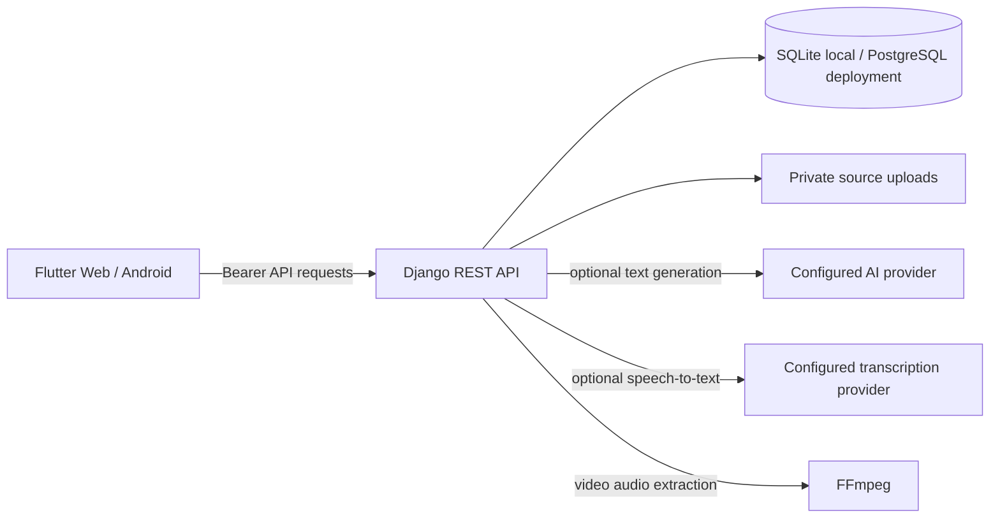

# Architecture and data flow

## System shape

The client is an app-style Flutter interface with responsive navigation. The API and product logic live in one Django deployment. Development uses SQLite and local media files; the same models can use PostgreSQL through `DATABASE_URL` for deployment.

## Main workflow

1. A user registers with an email address and password. Django's password hasher stores the credential; the API returns a bearer token for the Flutter client.
2. The user creates a text, audio, or video source. File extensions and upload size are checked at the API boundary.
3. Text sources are analyzed directly. Audio and video are transcribed through the configured provider; video requires FFmpeg to extract its audio.
4. The user reviews and can correct the transcript. The source analysis contains a topic, summary, key points, and important ideas.
5. The user selects Instagram, Facebook, or LinkedIn and one or more output types. Each result is a separate editable content item with its source and generation mode recorded.
6. The user can edit, regenerate, copy, download, schedule, reschedule, cancel, restore a cancelled draft, or delete a content item.

The calendar is a planning record; its times do not trigger publishing. The editor's manual share action copies the current text and opens the selected social network for the user to review and publish. There are no social account connections or automatic publishing calls.

## Data relationships

| Entity | Relationship and purpose |
|---|---|
| `User` | Owns sources, content, schedules, and history records. Email is the sign-in identifier. |
| `Source` | Belongs to a user and contains pasted text or a private media upload plus processing state. |
| `Transcript` | One editable transcript per source. Text sources use their original text as the transcript. |
| `SourceAnalysis` | One analysis per source, with topic, summary, key points, and important ideas. |
| `ContentItem` | A user's editable output for one source, platform, and content type. Status is draft, scheduled, or cancelled. |
| `ScheduledPost` | One planned time per content item. Cancelling the schedule keeps both the item and schedule record. |
| `ScheduleChange` | Records each schedule, reschedule, and cancellation action with prior and new times. |
| `GenerationEvent` | Records source processing, generation, edits, regeneration, and schedule changes. |

All API viewsets filter by the authenticated user before reading or mutating private records. Tokens expire after 14 days; each login replaces the account's previous active token.

## AI modes

- `AI_MODE=demo` is the no-key local presentation mode. It creates clearly labeled template-based drafts and a simple extractive analysis. It does not claim those results came from a model.
- `AI_MODE=openai` sends source text to the configured OpenAI Responses API model for analysis and platform adaptation. Audio transcription uses the configured transcription model. Set provider keys only on the Django server.
- Provider errors are returned as useful API errors. A source with failed transcription retains the uploaded file and can be retried after configuration is corrected.

## Boundaries and known limits

- Upload limit defaults to 20 MB. Processing happens during the request and is intended for short FYP demo files; long-running production workloads should add a background task queue.
- Video processing depends on FFmpeg installed on the backend host.
- Uploaded media is stored outside the Flutter static site and is not exposed as a public media URL. Production should use authenticated or signed object storage, HTTPS, and a managed database.
- The API token is stored in Flutter's secure storage plugin. Use HTTPS for any non-local deployment.
- There is no custom model training, video editing, social API publishing, or recommendation system in this scope. Social publishing needs platform-specific OAuth credentials, approved permissions, account eligibility, and appropriate public media hosting; local source uploads are private and generated outputs are text drafts.
